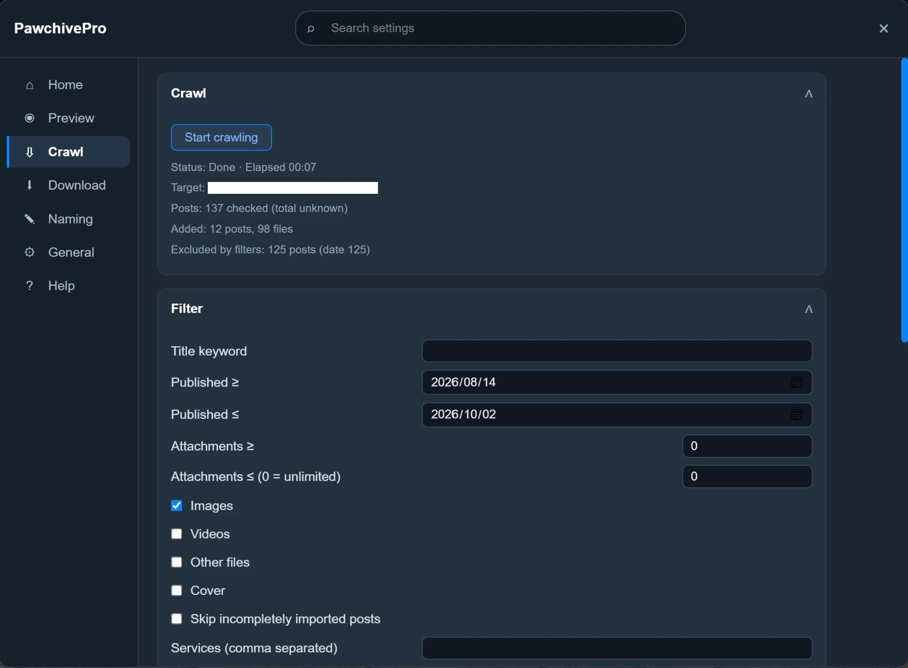
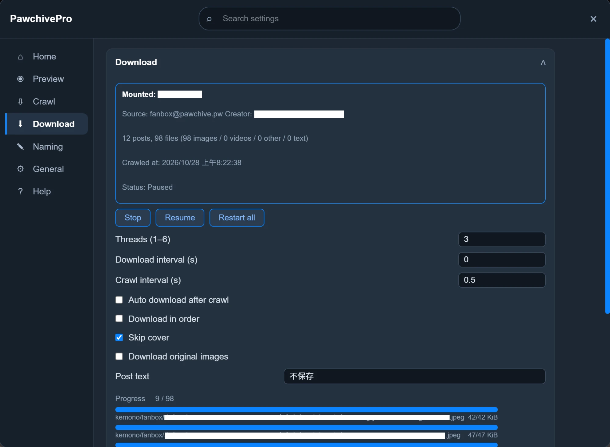
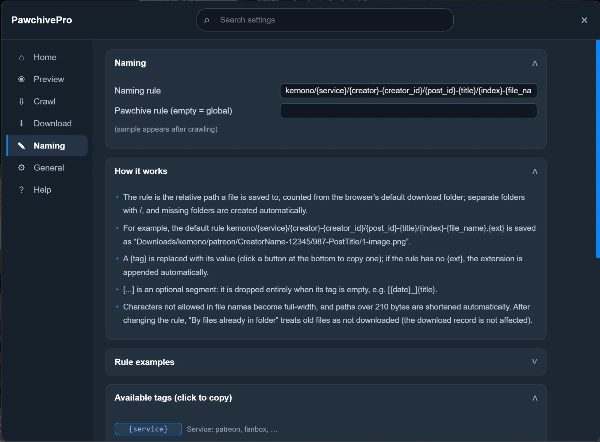

# PawchivePro

English | [繁體中文](README.zh-TW.md)

A Chrome / Edge (Manifest V3) extension for previewing and batch-downloading post attachments on Kemono-family sites:

- **Pawchive**: `pawchive.pw` (and subdomains) — the main, tested target.
- **Kemono**: `kemono.cr` (and subdomains, plus the legacy `kemono.su` / `kemono.party`) — **best effort, not verified**. Since October 2026 the original-file servers `n1`–`n4.kemono.cr` have been unreachable, so original-image downloads may fail.

License: **GPL-3.0-or-later** (see [LICENSE](LICENSE)).

## Features

- **Hover preview**: hover a thumbnail to see full images; switch with the mouse wheel.
- **Batch crawl**: crawl every post of a creator in one click, filtered by title, date, file type and more.
- **Reliable downloads**: pause, adjust concurrency, and retry failures automatically; files already downloaded or already in your folder are skipped.
- **Custom file names**: build download paths from tags such as `{creator}`, `{post_id}` and `{title}`.
- **Cache and history**: crawl results are saved for later downloads; download history can be exported and imported.
- **Hotkeys** and **four UI languages** (简体中文, 繁體中文, English, 日本語).

<p align="center">
  
  
</p>

<details>
<summary>Naming settings</summary>



</details>

## Install

There is no store listing. Build it yourself, or download the zip from [Releases](../../releases) and unzip it.

1. Build (Node.js 20+):

   ```sh
   npm ci
   npm run build
   ```

2. Open `chrome://extensions` (or `edge://extensions`), turn on **Developer mode**, click **Load unpacked**, and select the `dist/` folder.
3. Open a creator page on Kemono or Pawchive and click the button in the bottom-right corner (or press Alt+X).

After changing the code, run `npm run build` again and click reload on the extension card.

## Privacy

PawchivePro collects nothing. It has no analytics and no remote server; settings and history stay in your browser. Access to the download folder used for the existing-file check belongs to the extension; websites can't see it. See [PRIVACY.md](PRIVACY.md).

## Development

| Command | Description |
|---|---|
| `npm run build` | Production build: webpack (minified, no source maps) + less + copy static files into `dist/` |
| `npm run build:dev` | Development build: keeps source maps and prints debug output |
| `npm run check` | Type check + lint + format check + unit tests (what CI runs) |
| `npm test` | Run the vitest unit tests |
| `npm run make-icons` | Regenerate the icons in `src/icons/` |

Debug output is off in production builds. To turn it on, run `localStorage.setItem('pawchiveProDebug', '1')` in the page's DevTools console and reload.

### Layout

- `src/content.ts`: content script entry. `src/background.ts`: service worker (calls `chrome.downloads`).
- `src/crawl/`: crawl engine. `src/download/`: download pipeline, cache, history, local file check.
- `src/kemono/`: site API and URL rules. `src/preview/`: hover preview.
- `src/folder/` + `src/folder.ts`: the local-folder check. The folder is picked in an extension page (`folder.html`) and checked by the service worker; the content script only sends messages.
- `src/setting/`: settings and the settings panel (`pages/` has one module per panel page). `src/langText.ts`: UI strings in four languages.
- `src/EVT.ts`: internal event bus. It uses a private `EventTarget`, so page scripts cannot see or fire its events.

### Where site changes are most likely to break things

Each of these is kept in a single constant:

- Button mount points `.user-header__actions` and `.post__actions`: `MOUNT` in `src/kemono/pages.ts`.
- Kemono file servers `n1`–`n4.kemono.cr` and the hash routing: `FILESERVERS` in `src/kemono/assetsKemono.ts`.
- CORS / Referer header rules: `src/declarative_net_request_rules.json`.

## Disclaimer

PawchivePro is an independent project. It is not affiliated with Kemono, Pawchive, or any creator platform. Use it for personal archiving, and respect creators and the terms of the sites you use.

## Credits (GPL compliance)

This project is derived from two GPL-3.0-or-later projects:

- **PixivBatchDownloader** (PBD, v19.4.1) by xuejianxianzun —
  https://github.com/xuejianxianzun/PixivBatchDownloader —
  the general extension architecture (MV3 shell, event bus, download pipeline, filename engine, settings / i18n / toast scaffolding).
- **Kemono-Downloader** (KD, v1.11.3) — knowledge of the Kemono-family sites (API endpoints, asset URL rules, page detection, post expansion).

Ported files keep their original license header comments.
