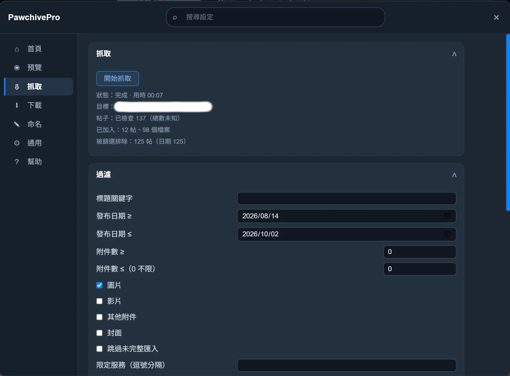
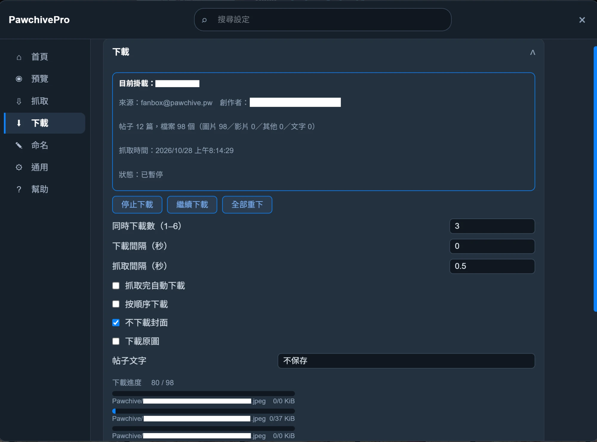
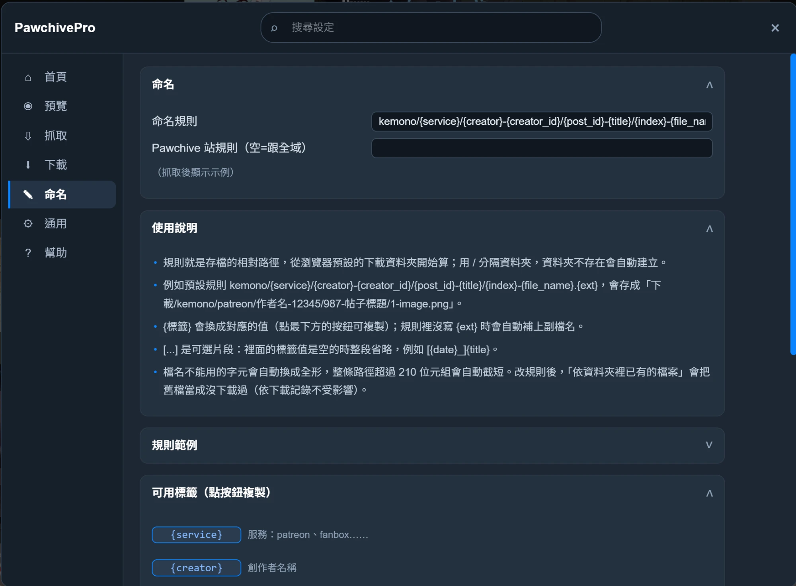

# PawchivePro

[English](README.md) | 繁體中文

Chrome / Edge（Manifest V3）擴充功能，用來預覽與批次下載 Kemono 系網站的帖子附件：

- **Pawchive**：`pawchive.pw`（含子網域）——主要支援、已實測的網站。
- **Kemono**：`kemono.cr`（含子網域與舊網域 `kemono.su`、`kemono.party`）——**盡力支援，未實測**。2026 年 10 月起原檔伺服器 `n1`～`n4.kemono.cr` 連不上，下載原圖可能會失敗。

授權：**GPL-3.0-or-later**（見 [LICENSE](LICENSE)）。

## 功能

- **懸停預覽**：滑鼠停在縮圖上看大圖，用滾輪切換。
- **批次抓取**：一鍵抓取創作者的全部帖子，可依標題、日期、檔案類型等條件篩選。
- **穩定下載**：可暫停、調整並行數，失敗會自動重試；已下載過或資料夾裡已有的檔案會略過。
- **自訂檔名**：用 `{creator}`、`{post_id}`、`{title}` 等標記組合下載路徑。
- **快取與記錄**：抓取結果會自動保存，之後可直接拿來下載；下載記錄可匯出／匯入。
- **快捷鍵**與**四種介面語言**（简体中文、繁體中文、English、日本語）。

<p align="center">
  
  
</p>

<details>
<summary>命名設定</summary>



</details>

## 安裝

沒有上架商店。請自行建置，或從 [Releases](../../releases) 下載 zip 解壓縮。

1. 建置（需要 Node.js 20 以上）：

   ```sh
   npm ci
   npm run build
   ```

2. 打開 `chrome://extensions`（或 `edge://extensions`），開啟「開發人員模式」，按「載入未封裝項目」，選擇 `dist/` 資料夾。
3. 打開 Kemono 或 Pawchive 的創作者頁，按右下角的按鈕（或 Alt+X）開啟面板。

之後改了程式碼，重新 `npm run build`，再到擴充功能頁按卡片上的重新載入即可。

## 隱私

PawchivePro 不收集任何資料，沒有分析追蹤，也沒有遠端伺服器；設定與記錄只存在你的瀏覽器裡。用來比對已有檔案的下載資料夾授權屬於擴充功能，網站看不到。詳見 [PRIVACY.md](PRIVACY.md)。

## 開發

| 指令 | 說明 |
|---|---|
| `npm run build` | 正式版：webpack（壓縮、無 source map）＋ less ＋ 複製靜態檔到 `dist/` |
| `npm run build:dev` | 開發版：保留 source map，並輸出除錯訊息 |
| `npm run check` | 型別檢查＋lint＋格式檢查＋單元測試（CI 跑的就是這個） |
| `npm test` | 執行 vitest 單元測試 |
| `npm run make-icons` | 重新產生 `src/icons/` 的圖示 |

除錯訊息在正式版預設不輸出；需要時在網頁的開發者工具 Console 執行 `localStorage.setItem('pawchiveProDebug', '1')` 後重新整理頁面。

### 目錄

- `src/content.ts`：內容腳本入口；`src/background.ts`：service worker（呼叫 `chrome.downloads`）
- `src/crawl/`：抓取引擎；`src/download/`：下載流程、快取、記錄、比對
- `src/kemono/`：站點 API 與網址規則；`src/preview/`：懸停預覽
- `src/folder/`＋`src/folder.ts`：本機資料夾比對。資料夾在擴充功能頁（`folder.html`）選擇，由 service worker 比對；內容腳本只負責傳訊息
- `src/setting/`：設定與設定面板（`pages/` 每個面板頁一個模組）；`src/langText.ts`：介面文字（四種語言）
- `src/EVT.ts`：內部事件匯流排，使用私有 `EventTarget`，網頁腳本看不到也無法偽造

### 依賴網站結構的地方

網站改版時最可能失效的是這幾處，各自集中在一個常數：

- 按鈕掛載點 `.user-header__actions`、`.post__actions`：`src/kemono/pages.ts` 的 `MOUNT`
- Kemono 檔案伺服器 `n1`～`n4.kemono.cr` 與分流雜湊：`src/kemono/assetsKemono.ts` 的 `FILESERVERS`
- CORS／Referer 標頭規則：`src/declarative_net_request_rules.json`

## 免責聲明

PawchivePro 是獨立專案，與 Kemono、Pawchive 及任何創作者平台無關。請用於個人收藏，並尊重創作者與所用網站的條款。

## 衍生與致謝（GPL 合規）

本專案衍生自兩個 GPL-3.0-or-later 專案：

- **PixivBatchDownloader**（PBD，v19.4.1），作者 xuejianxianzun —
  https://github.com/xuejianxianzun/PixivBatchDownloader —
  通用擴充功能架構（MV3 外殼、事件匯流排、下載流程、檔名引擎、設定／多語言／提示框骨架）。
- **Kemono-Downloader**（KD，v1.11.3）— Kemono 系網站知識（API 端點、資源網址規則、頁面判斷、帖子展開）。

移植的檔案保留原本的授權標頭註解。
